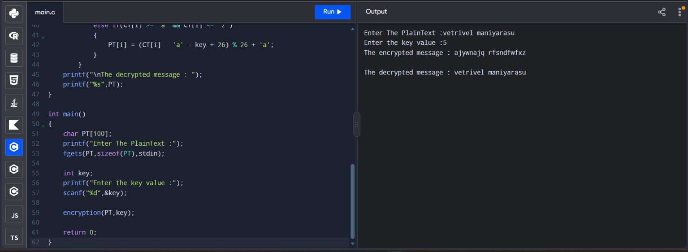

# EX. NO: 1(A) : IMPLEMENTATION OF CAESAR CIPHER

# Student Name : M.Vetrivel
# Register Number : 212225040487

## AIM:
To implement the simple substitution technique named Caesar cipher using C language.

## ALOGORITHM:

STEP-1: Read the plain text from the user.

STEP-2: Read the key value from the user.

STEP-3: If the key is positive then encrypt the text by adding the key with each character in the plain text.

STEP-4: Else subtract the key from the plain text.

STEP-5: Display the cipher text obtained above.

## PROGRAM:
```c
#include <stdio.h>
#include <string.h>

void decryption(char CT[],int key,char PT[]);
void encryption(char PT[],int key)
{
    char CT[100];
    for(int i=0; PT[i] != '\0'; i++)
        {
            if(PT[i] >= 'A' && PT[i] <= 'Z')
            {
                CT[i] = (PT[i] - 'A' + key) % 26 + 'A';
            }

            else if(PT[i] >= 'a' && PT[i] <= 'z')
            {
                CT[i] = (PT[i] - 'a' + key) % 26 + 'a';
            }
        }
    printf("The encrypted message : ");
    printf("%s",CT);
    decryption(CT,key,PT);
}

void decryption(char CT[],int key,char PT[])
{
    key = key % 26;
    for(int i=0; CT[i]!= '\0' ; i++)
        {
            if(CT[i] >= 'A' && CT[i] <= 'Z')
            {
                PT[i] = (CT[i] - 'A' - key + 26) % 26 + 'A';
            }

            else if(CT[i] >= 'a' && CT[i] <= 'z')
            {
                PT[i] = (CT[i] - 'a' - key + 26) % 26 + 'a';
            }
        }
    printf("\nThe decrypted message : ");
    printf("%s",PT);
}

int main() 
{
    char PT[100];
    printf("Enter The PlainText :");
    fgets(PT,sizeof(PT),stdin);

    int key;
    printf("Enter the key value :");
    scanf("%d",&key);

    encryption(PT,key);
    
    return 0;
}
```

## OUTPUT:



## RESULT :
 Thus the implementation of ceasar cipher had been executed successfully.
